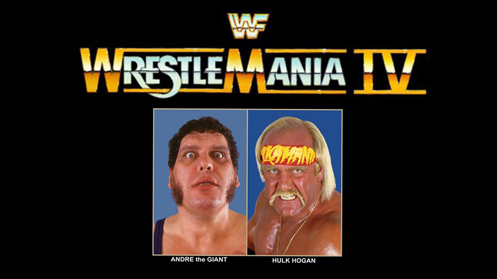

# WrestleMania 4

The Tournament of Madness and Million Dollar Meltdowns

16 Matches, One Title, and Enough Drama to Keep a Soap Opera Going for Years

{WATCH_ALONG_NOTE}

We open with Trump Plaza and some pretty cool spinning gambling coins emblazoned with the WWF logo. The red and blue ceiling gives off a funky look, and that wide shot of the crowd really gives you a feeling of the size of this WrestleMania. Mean Gene's already in the ring welcoming everyone, and Gladis Knight starts us off with a lovely rendition of America the Beautiful, complete with a montage of famous American traditions. Jesse and Gorilla are back on commentary together, and there's something beautifully nostalgic about this pairing that just hits different.

## 1. Bad News Brown wins the Battle Royal (last eliminates Bret Hart)

Let's start off with pure chaos: the WrestleMania Battle Royal. The refs are carrying a trophy to the ring followed by The Hart Foundation in some weird looking wrestling tights - looks like they forgot the pants? It's hard to explain, better to just see it for yourself. 

Watching heels and baby faces casually walking down to the ring without attacking each other was amusing, and interesting that baby faces were guided to the left and heels to the right when they came near the ring. This was essentially a clusterf*** that's pretty bad and probably worth skipping if you're short on time. Jim Brunzell just aimlessly walked around doing nothing of merit, and the crowd only really popped when Danny Davis was eliminated by Paul Roma - maybe they were just excited to see an ending.

**Bad News Brown** and **Bret Hart** spent far too long beating up Junk Yard Dog, and once JYD was eliminated, Bad News double crossed Bret and eliminated him. It was all a bit anti-climatic. Then Bret got some payback and trashed the trophy in what looked like some misguided attempt at turning him face, but really he just came across as a spoilt child. The crowd didn't know how to react since a few minutes ago he was a hated heel.

**Highlight:** Bret Hart proving that if he doesn't win, nobody gets a trophy - the ultimate sore loser move.

## 2. Ted DiBiase (with Virgil and André the Giant) defeated Jim Duggan (First round tournament match)

**Jim Duggan** rolled out without any music - the crowd was vocal but not by much. Andre came out with Ted and Virgil, because clearly this was going to be a fair fight. This was classic Duggan with black tights and white kneepads - my favorite version of his gimmick. Ted's silver and pink suit was so nostalgic it hurt.

Duggan got the crowd going with a "Hoooooo!" but Ted took a BIG atomic drop and got bounced out of the ring - what a bump! Duggan ended up bleeding from the mouth after eating a big boot to the face, but the real shocker was when Hacksaw busted out a sunset flip! Amazing. Even Jesse called it out. Andre tripped up Duggan, nailed him from outside, and Ted got the roll-up for the win.

This was an enjoyable match - short and sweet with good energy and action. Didn't need to be a marathon.

**Highlight:** Duggan pulling out a sunset flip and everyone wondering if they were seeing things.

---

Next we get a Brutus the Barber Beefcake interview with Mean Gene, and Gene stares at Brutus' groin and with no hint of irony says "wow, what a package." Man, Brutus was in phenomenal shape - incredible build and hotdog tan. Hogan must be proud of all the "hanging and banging."

---

## 3. Don Muraco (with Superstar Billy Graham) defeated Dino Bravo (with Frenchy Martin) by disqualification (First round tournament match)

Time for the roid monsters to do their thing. What the Hell was **Muraco** thinking he was doing off the second rope? He sorta was going for a big splash but bailed when he realized **Dino** was out of position and it just looked botched as Hell. These two just didn't have chemistry - neither guy had much personality and that came through in their wrestling.

There was a nasty spot where Muraco got his head caught in the ropes that looked painful. Big double clothesline but the crowd was quiet - no one seemed emotionally involved. After a ref bump, Dino got his finisher on but the ref came to and disqualified Dino for pulling the ref in front of Muraco (which caused the bump in the first place). 

This was OK but a bit of a chore to get through.

**Highlight:** Muraco's botched second rope attempt that looked as confused as everyone watching it.

---

Time for a Honky Tonk Man interview. The greatest intercontinental champion of all time. Just a shame it was so short. They needed more time to build some heat.

---

## 4. Greg Valentine (with Jimmy Hart) defeated Ricky Steamboat (First round tournament match)

**Ricky Steamboat** came out with a little dragon - poor kid had no clue what was happening, but pretty cool for him to bring his kid out at a WrestleMania. Everyone was expecting Ricky to win since they wanted to see a rematch between Ricky and Macho Man.

There was lots of back and forth in this match, nothing much to call out, but it was a decent match that was watchable and possibly even enjoyable. The surprise ending where **Valentine** got a clean win caught everyone off guard.

**Highlight:** Steamboat's kid getting the WrestleMania experience, even if dad couldn't get the win.

---

Time for an interview with The Bulldogs and Koko B Ware, setting up Matilda as a weasel hunting dog. This will be an interesting match for sure - all good workers plus Bobby the Brain Heenan equals magic.

---

## 5. Randy Savage (with Miss Elizabeth) defeated Butch Reed (with Slick) (First round tournament match)

I already knew I was going to love this - **Macho** is a legend and **'The Natural'** Butch Reed was one of my boys! The necklace on **Elizabeth** was immense and she was looking incredible. The cameras were flashing everywhere when Randy stood up on the ropes with his glorious blue sparkly gown.

There was a good shot of Butch battering Macho in the face repeatedly that looked nasty up close on camera. Elizabeth distracted Butch, giving Randy time to recovery, and then he nailed the quickest elbow drop finisher I'd ever seen him do. Cool to see the crowd immediately stand up in preparation for it.

This was an enjoyable match with great energy throughout.

**Highlight:** That lightning-fast elbow drop that had the crowd on their feet before it even connected.

## 6. One Man Gang (with Slick) defeated Bam Bam Bigelow (with Oliver Humperdink) by countout (First round tournament match)

As much as I love **OMG**, I'm not a fan of **Bigelow** and imagined this pairing to be quite a bland match up. That sparkly suit Bam Bam's manager was rocking was... wow. Intense, even for the 80s.

Two huge slabs of meat just punching and... well, punching. Bigelow pulled out a pointless cartwheel, which although impressive for someone his size, made no sense as it was clearly just going to gas him out. My main man **Slick** saved the day by pulling the top rope so Bigelow fell out, and that's it - we got a count out.

This was OK but a bit of a chore to get through.

**Highlight:** Bigelow's cartwheel that defied physics but defied logic even more.

---

Next up is an interview with Hulk Hogan, with the blue background really making Hulk's red/yellow and hotdog tan pop. Man, Hulk was talking some shite here about fault lines and saving Donald Trump and his family from sinking into the ocean.

---

## 7. Jake Roberts vs. Rick Rude (with Bobby Heenan) ended in a time-limit draw (First round tournament match)

I love **Rick Rude** and how he bumps around for his opponents. I also love **Jake** and his gimmick, but I always find his matches lacking substance. Some good back and forth between Rude and Jake, then a nice spot where Rude was laying in the same corner as the snake bag and got a rude awakening (pun intended).

The psychology of the match was a bit weird - Jake's finisher is the DDT and yet he spent all his time working Rude's arm. Maybe in kayfabe it's to prevent Rude pulling his finisher. The commentary regularly mentioned the 15min time limit, so we knew we'd be seeing a draw and they'd both be eliminated from the tournament.

They sure dragged out this reverse chin lock, going back to it over and over. Surely they could have come up with something better. Jake looked messed up in the kayfabe sense - he was selling it properly but this was the 5th time they went for the reverse chin lock and the crowd was audibly booing and shouting "BORING." Jake made a comeback and fired up the crowd who were ready for the end.

This was OK but a bit of a chore to get through.

**Highlight:** The crowd shouting "BORING" - you never want to hear that at WrestleMania.

---

We get Vanna White and Mean Gene going through the matches coming up and how the tournament is shaping up. Not much to say about this segment - it helped remind people of what was actually happening.

---

## 8. The Ultimate Warrior defeated Hercules (with Bobby Heenan)

Two muscle bound roid heads - both men had incredible physiques. At least **Warrior** had a tan while **Hercules** was milky white. Not much wrestling to speak of, just punching, maybe some kicking. Mostly punching.

Full nelson into a spin and it looked like Hercules won it but Warrior managed to get his shoulder up so Warrior wins. Quick match and nothing of interest happened.

This was pretty bad and probably worth skipping if you're short on time.

**Highlight:** Hercules' milky white complexion making Warrior's tan look even more radioactive.

## 9. Hulk Hogan vs. André the Giant (with Ted DiBiase and Virgil) ended in a double disqualification (Quarter-final tournament match)

We started with a flashback of the feud so far - feels like I've seen this so much in the lead up to WrestleMania. **Andre** looked massive coming into the ring, a very imposing figure. Out came **Hulk** and the crowd went batshit crazy.

Hogan got the early advantage but then Andre brutalized him. Andre was definitely working harder here than in WrestleMania 3 where he just casually beat up Hogan. Hogan made his comeback and **Dibiase** nailed Hogan with a chair. For some reason the ref didn't disqualify Hogan immediately? He opted to disqualify both Andre and Hogan - terrible booking.

Hogan then suplexed **Virgil** on the outside concrete but ever the heel, didn't take the bump with Virgil. He just dropped him on the floor. Again Hogan was posing like he won something - he's the loser! None of this celebrating made sense. Surely Hogan would be furious that he lost his chance to win the title!?

This was an enjoyable match, probably got a higher rating just because it's Hogan and Andre.

**Highlight:** Hogan celebrating a loss like he just won the lottery - peak Hogan logic.

---

Quick Macho interview and straight away he defended Hogan and claimed Hogan was behind him. Seriously, they were sprinkling that magic Hulk dust for Macho, getting the fan support for sure after that.

---

## 10. Ted DiBiase defeated Don Muraco (with Superstar Billy Graham) (Quarter-final tournament match)

Beautiful power slam from **Muraco** - he always did those so well. He was showing some decent wrestling moves here, actually surprising. **Ted** got a second win and we got a beat down on Muraco for the next 5 minutes. Nothing special to report, fairly standard affair. Ted got the win after dropping Muraco's neck onto the top rope - clean win.

This was pretty bad and probably worth skipping if you're short on time.

**Highlight:** Muraco's power slam reminding everyone he could actually wrestle when he felt like it.

---

Demolition interview - love these guys. Their interviews were great, the face paint was so colourful. Mr. Fuji was here with them solidifying their bad guy status.

One Man Gang walked to the ring and then walked all the way back because he had a bypass to the next round. Bit stupid really considering he would have known he wouldn't be having a match, but this was all to tell the story for the people in the arena.

---

## 11. Randy Savage (with Miss Elizabeth) defeated Greg Valentine (with Jimmy Hart) (Quarter-final tournament match)

**Macho** and **Liz** were both in different outfits - so cool they did this. Really made them stand out and seem an even bigger deal. Some nice back and forth, with Macho pulling out lots of agility moves, while **the Hammer** was old school plodding punching and kicking.

The commentary was good, really telling the story and more importantly the "opportunity" this tournament was giving all these wrestlers. Now Hogan and Andre were out it was almost like anything was possible. Although let's be honest, only Macho could win this at this point, but commentary was selling it like it was still anyone's game.

It was almost like the ref told them to wrap it up because Macho just burst out a bunch of spots, but all for naught as Hammer got back in control. Hammer went for the figure four leg lock and Macho pulled a small package for the win - nice, clean and unexpected.

This was an enjoyable match with good storytelling throughout.

**Highlight:** Savage and Elizabeth's costume changes throughout the night - true WrestleMania glamour.

## 12. Brutus Beefcake defeated The Honky Tonk Man (c) (with Jimmy Hart and Peggy Sue) by disqualification (Singles match for the WWF Intercontinental Championship)

So this one's for the intercontinental championship - I'm sure everyone here thought **Brutus** was gonna steal the win. **Brutus** messed up **Honky's** hair - good psychology as Honky loved his hair styling. Brutus' outfit looked a bit strange - not sure if it's the boots? Fun fact: his Hasbro figure was based on this outfit.

Brutus' facial expressions were legendary bad. **Jimmy Hart** earned his pay getting involved with some dirty tactics. That spot was so dumb - Honky was about to do his finisher in the middle of the ring and then stopped, then dragged Brutus to the side near the ropes so that when he went for it again Brutus could grab the ropes and start his comeback.

Sleeper hold on and the crowd popped like crazy. The acting credentials of Brutus were just legendarily bad - he thought he was gonna get the title. Poor **Jimmy** was being forced by a muscle bound wrestler to have a haircut. As a kid I always wanted Brutus to use the big shears.

This match was watchable and possibly even enjoyable for the spectacle.

**Highlight:** Brutus' acting being so bad it became genuinely entertaining.

## Andre Interview

This is CLASSIC! Love this segment with **Andre**. So much fun. That shot of him strangling this poor little man was incredible.

## 13. The Islanders (Haku and Tama) and Bobby Heenan defeated The British Bulldogs (Davey Boy Smith and Dynamite Kid) and Koko B. Ware

**Heenan** was a comedy genius, coming out dressed up in the dog trainer outfit. I feel like I love the memory of **the Bulldogs** rather than the reality? Rose tinted glasses mostly only carry you so far (that said their SummerSlam 1988 match is brilliant). So we've got **Koko** out in this six-man tag - should be interesting.

It looked like **Haku** and **Davey Boy** did a double cross-body on each other. Great spot by Koko where he had a head scissors and a headlock on two guys at once. **Heenan** wins the match!? The islanders picked up Heenan for a slam on Koko.

They tried desperately to get the dog Matilda to attack Heenan and it just didn't. Davey Boy had to literally pick up the dog and place it on the back of Heenan.

This match was watchable and possibly even enjoyable for the chaos.

**Highlight:** Davey Boy having to manually position a confused dog for the post-match "attack."

## Jesse The Body Ventura

We segway into a little slot for Jesse to show off his muscles. Not sure what this was in aid of.

## 14. Randy Savage (with Miss Elizabeth) defeated One Man Gang (with Slick) by disqualification (Semi-final tournament match)

**Macho** came out in a glorious black sparkly robe. Jesse hyped up the match by explaining how hard it would be for Savage to beat **OMG** considering the gang had had a bye in one of his matches. This ref was a real shouter, screaming at OMG to break holds.

The crowd felt dead here - they came alive a bit when OMG missed a big splash and when Macho went up top for a double-axhandle on the outside. Macho lost his mind and attempted to slam OMG!? 

Now OMG lost his mind and started to hit Macho with **Slick's** cane, right in front of the ref so he got an obvious disqualification. This was just bad booking. Macho got his heat back by nailing OMG from behind.

This was OK but a bit of a chore to get through.

**Highlight:** Macho attempting to bodyslam a man the size of a small building - ambitious but futile.

## 15. Demolition (Ax and Smash) (with Mr. Fuji) defeated Strike Force (Tito Santana and Rick Martel) (c) (Tag team match for the WWF Tag Team Championship)

**Strike Force** had such a white meat babyface theme it made me cringe. **Ax** had some crazy face paint - looked like a black butterfly just crashed straight into his face. I always got nostalgic seeing **Smash's** left bicep padding (originally used to cover up his tattoo so no one would notice he was actually Krusher Khrushchev in the NWA, but kept wearing it even years after being in the WWF), and also that weird blue right kneepad configuration where it looked like some kind of Stone Cold Steve Austin leg brace.

Smash started with some big power moves and picked up **Martel** for a slam but **Tito** came in for the rescue... by drop kicking his partner in the back lol. I'll never understand that spot - you're hurting your partner! Just push or trip the opponent up!?

Some quick back and forth between both teams. Jesse got all confused about the tag rules and the 5 count - normally he was spot on with his perspective/analysis but I think he must have been tired as I couldn't make sense of it. For once **Gorilla** was making sense.

Demolition used their sneaky ways to get the advantage and followed up with a lot of double teaming. Jesse with a great line: "I bet Tito wishes he was back selling tacos in tijuana." Smash pulled out a BIIIIG suplex - bit out of place for Demolition as they're not usually doing actual wrestling moves. Man, Ax always skipped leg day.

Martel got the hot tag and he was doing all his baby face poncing around while simultaneously cleaning house. Martel got the Boston Crab on Smash and would have got the submission if not for Ax distracting the ref. Tito jumped in and nailed **Fuji** who dropped the cane (of course we could tell what happens next). Ax grabbed it and nailed Martel to steal the win and the titles.

This match was watchable and possibly even enjoyable for the tag team storytelling.

**Highlight:** Jesse's "selling tacos in tijuana" line - politically incorrect but undeniably funny.

## 16. Randy Savage (with Miss Elizabeth) defeated Ted DiBiase (with André the Giant) (Tournament final for the vacant WWF World Heavyweight Championship)

We got a shot of the new "winged eagle" championship belt - the greatest belt of all time made by the legend Reggie Parks. Out came **Ted DiBiase** wearing his not traditional but still classic Silver and Pink suit, followed by **Andre**. Cameras always shooting up when Andre was about made him look even MORE huge.

Here came **Macho and Elizabeth** in yet another outfit - this time the classic orange pants. The match started off without much tension, just a simple tie up and straight away we got an Andre distraction which caused the crowd to start cheering for **Hogan**.

Ted had a good run beating on Macho at the start but Macho managed to get back on top before Ted again got the lead on him - lots of back and forth. Macho wanted to nail Ted on the outside from the top rope but Andre blocked him. Macho sent Elizabeth back and the commentators didn't say what they thought would happen but they were being so blatant about SOMETHING about to happen.

And just like that, quick as a flash out came Elizabeth with **Hogan**. There wasn't much drama in the match itself - more about Hulk and Andre and their work outside the ring, taking away from the match. I blinked and Macho won with the help of Hogan and a chair shot to the back of Ted followed by a Macho man elbow from the top rope.

This match felt lacklustre and was more about Andre and Hogan than anything else. Sorry Macho, you deserved better, especially considering he had to get Hogan's help to win. Macho should have won clean at the very least.

This was an enjoyable match, mostly for the drama outside of the ring (unfortunately it took away from the match itself).

**Highlight:** The "winged eagle" belt making its debut - arguably the most beautiful championship ever created.

## The Legacy: When Wrestling Was Pure Magic, Even When It Was Pure Chaos

Look, let's be honest here - WrestleMania IV was a beautiful mess. Sixteen matches, countless disqualifications, and more botched spots than you could shake Hacksaw's 2x4 at. We watched Hercules's milky white physique get schooled by the Ultimate Warrior's radioactive tan. We witnessed Jim Brunzell wandering around the battle royal like a lost tourist at Disney World. We endured Jake Roberts and Rick Rude making love to a chin lock for what felt like seventeen hours while the crowd screamed "BORING" at the biggest wrestling event of the year.

And yet... and yet there was something absolutely magical about it all.

This was wrestling in its purest, most unfiltered form - where Jesse Ventura could crack jokes about Tito Santana selling tacos in Tijuana, where Mean Gene could stare at Brutus Beefcake's groin and deadpan "wow, what a package," where Andre the Giant could strangle a poor interviewer and we'd all laugh because that was just Andre being Andre. It was wonderfully, gloriously ridiculous.

But beneath all that beautiful chaos was something we've lost in today's hyper-produced wrestling world: genuine emotion. When Randy Savage hit that lightning-fast elbow drop and the crowd immediately stood up in anticipation, that wasn't manufactured. When Hulk Hogan showed up to help Macho Man win the title, the pop was real. When we saw that gorgeous winged eagle championship for the first time, courtesy of the legendary Reggie Parks, it felt like witnessing history.

Sure, Macho deserved to win that title clean without Hogan's help. Sure, half the matches ended in disqualifications that made no sense. Sure, Bam Bam Bigelow's cartwheels defied both physics and logic. But that's exactly what made it perfect. This wasn't wrestling trying to be something else - it was wrestling being wrestling, in all its over-the-top, slightly bonkers glory.

WrestleMania IV reminds us of Saturday mornings spent in front of the TV with a bowl of cereal, believing every word that came out of Mean Gene's mouth. It takes us back to a time when the biggest controversy was whether Brutus would use the big shears, when Jesse and Gorilla's banter felt like listening to your favorite uncles argue at Christmas dinner, when Miss Elizabeth changing outfits three times in one night was the height of glamour.

It was a simpler time, before we analyzed workrate and scrutinized booking decisions, before social media turned every wrestling fan into a critic. We just sat there, wide-eyed and completely absorbed, watching larger-than-life characters battle for glory in the most dramatically overwrought way possible. And we loved every ridiculous, nonsensical, absolutely perfect minute of it.

That's what we really miss, isn't it? Not just the wrestling, but that feeling of pure, unironic joy. The kind that could only exist in an era where a man could win a championship tournament with the help of his best friend, celebrate with his glamorous manager, and have it feel like the most natural thing in the world. In a time when adventure meant turning on the TV and letting your imagination run wild, when the biggest special effect was a well-timed camera flash, when heroes were heroes and villains got their comeuppance, even if it took all night to get there.

WrestleMania IV wasn't just a wrestling show - it was a four-hour escape into a world where anything could happen, and usually did. And in our increasingly complex, digital world, sometimes that's exactly the kind of beautiful, uncomplicated magic we need to remember.
